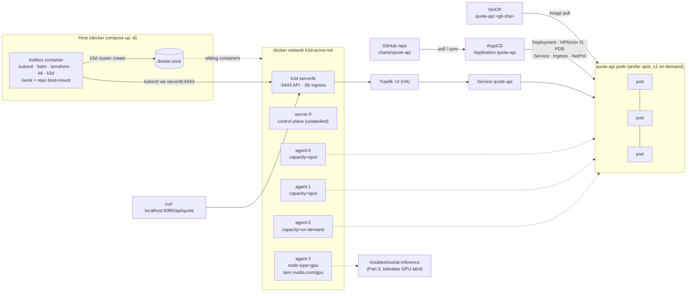
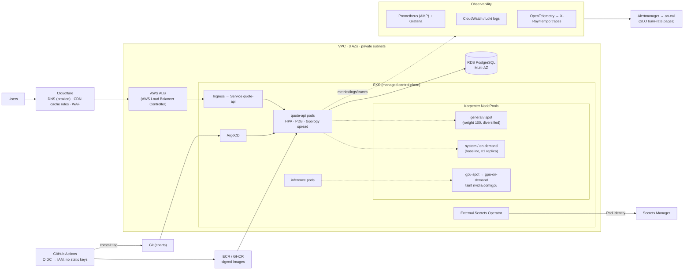

# DevOps take-home: quote-api on a 4-nodepool k3d cluster, GitOps with ArgoCD

## Quick start

```bash
git clone https://github.com/thaobk54/devops-takehome && cd devops-takehome
docker compose up -d          # toolbox + k3d cluster (1 server, 4 agents) + nodepool labels
./scripts/run-all.sh          # every numbered script, in order (all are idempotent)
curl http://localhost:8080/api/quote
```

- **Requirements:** Docker (Desktop) with at least 4 CPU and 6 GB RAM, plus `bash`. On Windows, use Git Bash.
- **Bootstrap time:** about 1–2 min on first start. `./scripts/run-all.sh` waits for it on its own. To watch progress: `docker compose logs -f toolbox`.
- **Tear down:** `./scripts/99-teardown.sh`.

## Architecture



**CI/CD path (Part 4):** you push to `main`. GitHub Actions then runs `test` and `sast` (Semgrep, hard gate). If both pass, `build` runs: Trivy gate, push to GHCR tagged with the git SHA, cosign signature. Last, `gitops-bump` commits the new tag to `values.yaml` with `[skip ci]`, and ArgoCD syncs it. CI never holds cluster credentials.

## Script reference

| Script | What it does | When |
|---|---|---|
| `scripts/run-all.sh` | Runs every `NN-*.sh` in order. Works from the host (re-runs itself inside the toolbox) or from inside the toolbox. | Always the entry point |
| `scripts/10-wait-cluster.sh` | Waits for the compose bootstrap, checks nodepool labels and taints, waits for CoreDNS, Traefik and metrics-server. | First |
| `scripts/15-platform.sh` | Makes the ingress highly available: Traefik ×2 + PDB through a k3s `HelmChartConfig`. | Before deploying |
| `scripts/20-deploy.sh` | Installs ArgoCD (pinned OCI chart) and applies the `Application`, which syncs `charts/quote-api` from Git. Waits for `Synced/Healthy`, then curls through the Ingress. | Part 2 |
| `scripts/25-reclaim-drill.sh` | Runs a curl loop at 5 req/s, drains a spot node (respecting the PDB), shows rescheduling, then always uncordons. Fails if success is below 99%, if pods are left on the drained node, or if no replica is on on-demand. | Part 2 |
| `scripts/30-troubleshoot.sh` | Applies `troubleshoot/fixed-app.yaml` and runs `troubleshoot/verify.sh`. Must print **PASS**. | Part 3 |
| `scripts/50-validate-tf.sh` | Part 5: `terraform fmt -check`, `init -backend=false` and `validate` for `iac/cloudflare`. Installs the real Karpenter v1.15 CRDs (schemas only) and server-side dry-runs `iac/karpenter`. Then runs the IaC policy tests. | Part 5 |
| `scripts/90-e2e-tests.sh` | End-to-end pytest suite: cluster, GitOps, placement, self-heal, NetworkPolicy least-privilege. | Last |
| `scripts/99-teardown.sh` | Deletes the k3d cluster, then runs `compose down -v`. Never run by `run-all`. | Cleanup (run on the host) |

**Tests outside the cluster:**

- `app/tests`: unit tests (`cd app && pytest`).
- `tests/image`: image tests (non-root, read-only rootfs, size).
- `tests/static`: Helm chart, Karpenter, Terraform and documentation policy tests.

All of these also run in CI.

## Hands-on tracks chosen
- **Part 4 (CI/CD migration):** `.github/workflows/ci.yml` and `MIGRATION-NOTES.md`.
- **Part 5 (IaC, validate-only):** `iac/karpenter/` (GPU NodePools, spot preferred, plus the trade-off paragraph in its README), `iac/cloudflare/` (proxied record, cache rules, `import` block), and `scripts/50-validate-tf.sh`.
- **Part 6 not done on purpose.** One or two tracks done properly beat three rushed, and kube-prometheus-stack alongside ArgoCD and 5 k3s nodes is heavy for a laptop. The app already exposes `/metrics` (counter + histogram) and the pods carry scrape annotations, so Part 6 would mostly be the monitoring stack plus k6.

## Design decisions & trade-offs

- **The toolbox creates the cluster.** It does this through the host `docker.sock`, on a network that compose itself defines. So `docker compose up -d` really is the only step, and the toolbox reaches the API by container name (`k3d-acme-serverlb:6443`) with no host networking. That matters because Docker Desktop on Windows/macOS doesn't support host networking well.
- **Placement** (`charts/quote-api/values.yaml` → `placement`):
  - A *required* node affinity on `acme.io/capacity In (spot, on-demand)` keeps pods off the GPU node and the unlabelled k3s server.
  - A *preferred* affinity (weight 100) favours spot.
  - A topology spread on `acme.io/capacity` with `maxSkew 1, DoNotSchedule` guarantees at least one replica on on-demand. If every spot node disappeared, that domain would disappear too, so pods still schedule and nothing deadlocks.
  - A topology spread on `hostname` with `ScheduleAnyway` keeps the node spread soft, so a drain never leaves pods Pending.
  - *Trade-off:* `maxSkew 1` across capacity types means that when the HPA scales out, about half the replicas land on on-demand. The alternative, a separate always-on-demand "anchor" Deployment, guarantees the same thing at a constant cost, but it splits HPA and PDB across two objects. I chose one Deployment for simplicity.
  - *Trade-off:* after a drill, two replicas can share a spot node. Nothing rebalances them without a descheduler, which I left out.
- **HA ingress.** k3s ships a single Traefik replica, so a drill would have measured an *ingress* outage whenever Traefik sat on the drained node. Two replicas plus a PDB fixed that. Repeated drills then still showed about 4% connection errors, and only when a Traefik pod was evicted: Traefik stops accepting on SIGTERM before its endpoint is removed. `requestAcceptGraceTimeout=5s` (the same idea as the app's `preStop` sleep) took repeated drills to 100%.
- **HPA vs ArgoCD.** The Deployment has no `spec.replicas` when the HPA is on, so ArgoCD's self-heal never fights the autoscaler.
- **App:** Python/Flask on gunicorn, with one worker and four threads.
  - A single process keeps `prometheus_client` correct without multiprocess mode. Scaling is horizontal, through the HPA.
  - Threads keep `/healthz` fast while `/api/quote` burns roughly 100 ms of real CPU. The CPU time is measured with `time.thread_time()`, not `sleep`, so load tests and the HPA see real CPU.
- **Image:** multi-stage build on Alpine, about 94 MB, UID 10001, no pip in the venv, read-only rootfs compatible. It is tagged with the git SHA. `latest` exists only as a convenience pointer and the chart refuses it.
- **NetworkPolicies everywhere it matters.** The app accepts traffic only from kube-system (Traefik) and monitoring, and has no egress. Part 3 adds explicit least-privilege rules.
- **SAST scope.** Semgrep skips three things on purpose: the provided fixtures (`troubleshoot/`, `ci/legacy…`), which are insecure by design; tests; and the local-only toolbox, which runs as root to drive `docker.sock`. All of these are listed with reasons in `.semgrepignore`. A gate that is always red is as useless as one that can never fail.
- **Cut:** a descheduler, ArgoCD UI exposure, cert-manager/TLS on the local ingress, and Prometheus/k6 (Part 6 not chosen, see above). Each is easy to add, but none is needed to show the required behaviour.

## Bonus: the same service in production on AWS



## Troubleshooting (reviewer machine)

1. **Port 8080 or 6550 already in use.** `k3d cluster create` fails. Free the port, or change `ports`/`kubeAPI.hostPort` in `bootstrap/k3d-config.yaml`, then run `./scripts/99-teardown.sh && docker compose up -d`.
2. **Not enough resources.** Agents never become Ready, or pods stay Pending. Give Docker Desktop at least 4 CPU and 6 GB RAM. Check `docker compose logs toolbox`. The bootstrap writes `/root/.kube/failed` and prints the reason.
3. **Windows line endings.** If you see `'bash\r': No such file or directory`, the repo was checked out with CRLF. `.gitattributes` forces LF, but a clone made with an old global `core.autocrlf=true` can still convert. Re-clone after `git config --global core.autocrlf input`.
4. **Apple Silicon.** The images are published for `linux/amd64` and `linux/arm64`.

## Further documents
- [TROUBLESHOOTING.md](TROUBLESHOOTING.md): Part 3, each issue with its symptom, commands, root cause and fix.
- [MIGRATION-NOTES.md](MIGRATION-NOTES.md): Part 4, GitLab → GitHub Actions.
- [AI-USAGE.md](AI-USAGE.md) · [OPS-ANSWERS.md](OPS-ANSWERS.md)
